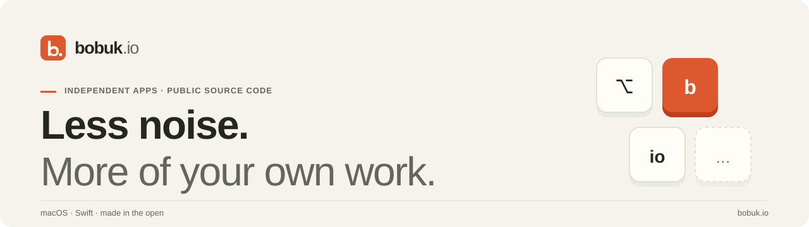
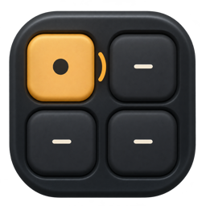
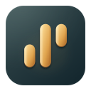
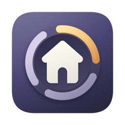

<!-- Generated by npm run prepare:profile. Edit design/catalog.json or scripts/profile.mjs. -->

<a href="https://bobuk.io/">
  <picture>
    <source media="(prefers-color-scheme: dark)" srcset="https://raw.githubusercontent.com/bobuk-io/.github/main/profile/assets/banner-dark.svg">
    
  </picture>
</a>

Small native macOS tools that solve a specific problem and respect your time.
Public source code, focused apps, and a place to ask for help.

[Explore the apps, installation guides and support →](https://bobuk.io/)

### Apps

<table>
  <tr>
    <td width="88" align="center"></td>
    <td>
      <b><a href="https://github.com/bobuk-io/ting">Ting</a></b> · for your keyboard 
      <b>Your next app. A few keys away.</b> A leader-key launcher: press a leader, then a key or two to open an app, a link or a micro-app. 
      <code>brew install --cask bobuk-io/tap/ting</code>
    </td>
  </tr>
  <tr>
    <td width="88" align="center"></td>
    <td>
      <b><a href="https://github.com/bobuk-io/splash-finish">Splash Finish</a></b> · for working with AI 
      <b>Your agents work. You stay focused.</b> A native landing strip for Claude Code, Codex and pi sessions that are done or need your attention. 
      <code>brew install --cask bobuk-io/tap/splash-finish</code>
    </td>
  </tr>
  <tr>
    <td width="88" align="center"></td>
    <td>
      <b><a href="https://github.com/bobuk-io/HAScS">HAScS</a></b> · for your home 
      <b>Your home scenes. One key away.</b> A menu-bar selector for Home Assistant scenes. 
      <a href="https://bobuk.io/apps/hascs/">Install →</a>
    </td>
  </tr>
  <tr>
    <td width="88" align="center"></td>
    <td>
      <b><a href="https://github.com/bobuk-io/lowkey">Lowkey</a></b> · for the web · source preview 
      <b>A quiet browser for the sites you live in.</b> Minimal WebKit windows with per-site profiles, aliases and keyboard-first control. 
      <a href="https://github.com/bobuk-io/lowkey#install-from-source">Build from source →</a> · No binary release yet.
    </td>
  </tr>
</table>

### How we build

- **One thing, done well.** Not an everything app — a tool that fits into an ordinary day.
- **The code is no secret.** Read how it works, open an issue, suggest a change.
- **Somewhere to ask.** Find app information and support on [bobuk.io](https://bobuk.io/).

### Under the hood

<a href="https://github.com/bobuk-io/homebrew-tap"><code>homebrew-tap</code></a> — official Homebrew casks ·
<a href="https://github.com/bobuk-io/BobukKit"><code>BobukKit</code></a> — shared native UI components ·
<a href="https://github.com/bobuk-io/bobuk-io.github.io"><code>bobuk-io.github.io</code></a> — the catalog site

<a href="https://bobuk.io/">English</a> · <a href="https://bobuk.io/ru/">Русский</a> · <a href="https://bobuk.io/uk/">Українська</a>
